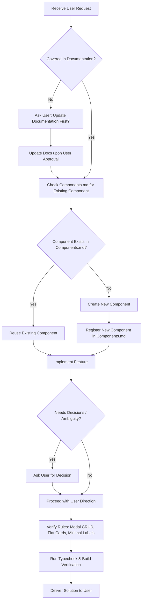

# Agent Operating Guidelines & Rules (`Agent.md`)

This document defines the strict operating rules, architectural boundaries, and behavioral standards for any AI agent or developer working on the **E-Commerce** codebase.

---

## 1. Absolute Golden Rules

### Rule 1: No Autonomous Decisions — Always Ask the User
- **Never make unilateral decisions** regarding architecture, database schemas, state management libraries, UI layout restructuring, new features, or removing existing functionalities.
- When multiple viable technical or design approaches exist, **present the options clearly with trade-offs and ask the user to decide**.
- If requirements are ambiguous, pause and ask for clarification rather than assuming or guessing.

### Rule 2: Documentation-First Protocol
- If a requested change, feature, or design pattern is **not covered in the documentation** (`Agent.md`, `design.md`, or `Components.md`), you **must ask the user first**:
  > *"This update is not specified in the project documentation. Should we update the documentation first before proceeding with the implementation?"*
- Always keep `Agent.md`, `design.md`, and `Components.md` updated and in sync with the codebase.

### Rule 3: Reusable Component Registry Protocol (`Components.md`)
- **Before creating or remaking any component**:
  1. Inspect `Components.md`.
  2. If a component serving that purpose already exists, **reuse it directly**. Do not re-create or duplicate components.
  3. If a component does not exist and you build a new reusable component, you **must immediately list and document it in `Components.md`** with its props, file path, and usage example.

### Rule 4: All Create & Edit Workflows as Popup Modals
- **All creation and editing flows must be presented inside a popup modal (`Dialog`)**.
- Never redirect to a separate full-page form or expand inline rows for entity creation/editing (e.g., Add Product, Edit Product, Update Address, Add Category).
- Modals must be focused, clean, centered, and dismissible (via Cancel button, close icon, or Escape key).

### Rule 5: Delete Confirmation Modal Required
- **Never delete or trigger destructive actions directly on click.**
- Every delete action (e.g., delete product, remove item, clear cart) **must trigger a dedicated Delete Confirmation Modal**.
- The confirmation modal must:
  - Clearly state what entity is being deleted.
  - Warn that the action is irreversible.
  - Provide a safe "Cancel" button and a highlighted destructive "Delete" button.

### Rule 6: Flat Cards Only — No Nested Cards
- **All cards must be flattened.**
- **Never nest cards** (i.e., placing `<Card>` inside another `<Card>`).
- To segment information inside a card, use flat layouts: clean flex/grid divisions, subtle borders, or dividers—never sub-cards.

### Rule 7: Remove Unwanted Text Labels & Descriptions
- Keep the user interface uncluttered, modern, and minimal.
- **Eliminate redundant text labels** (e.g., avoid writing `"Name: Product Title"` when `"Product Title"` alone conveys the information; avoid `"Price: $99.99"` when `"$99.99"` with price styling is self-explanatory).
- Strip out verbose instructional descriptions, filler paragraphs, and excessive placeholder texts.
- Leverage clean typography, subtle badges, and intuitive icons (with accessible labels) instead of cluttering the UI with unnecessary text.

---

## 2. Project Architecture & Tech Stack

| Layer | Technology |
|---|---|
| **Framework** | React 18 + TypeScript |
| **Build Tool** | Vite |
| **Styling** | Tailwind CSS + `tailwindcss-animate` |
| **UI Primitives** | Radix UI primitives (`@radix-ui/react-slot`), shadcn/ui pattern |
| **Icons** | Lucide React (`lucide-react`) |
| **Database & Auth** | Supabase (`@supabase/supabase-js`) |
| **Class Utilities** | `clsx` + `tailwind-merge` (`cn` helper in `@/lib/utils`) |

---

## 3. Standard Agent Workflow

---

## 4. Pre-Flight Verification Checklist for Agent

Before presenting any code or solution to the user, the agent must verify:
- [ ] **No unilateral decisions made** — Any forks in design/architecture were confirmed with the user.
- [ ] **Documentation alignment** — Any new concepts were vetted and documented in `design.md` or `Components.md`.
- [ ] **Reusable components checked** — No duplicates created; new reusable components registered in `Components.md`.
- [ ] **Create/Edit operations** — Implemented strictly as popup modals.
- [ ] **Delete operations** — Protected by a Delete Confirmation Modal.
- [ ] **Card structure** — Flat cards only; no nested `<Card>` components.
- [ ] **Visual clutter removed** — No unwanted text labels, redundant descriptions, or verbose clutter.
- [ ] **TypeScript verification** — No compilation errors (`npm run build` or `tsc --noEmit`).
