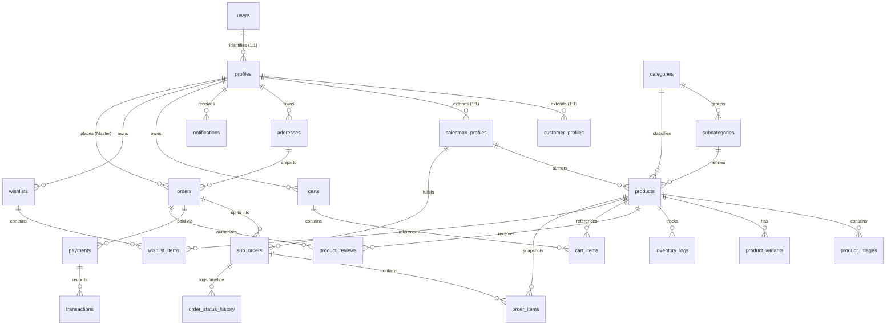

# E-COMMERCE MULTI-VENDOR MARKETPLACE
## Relational Database Schema & Architecture Specification

---

### Document Control
- **Database Engine:** PostgreSQL 15+ (Supabase Managed)
- **Document Version:** 1.0.0
- **Architectural Standard:** 3rd Normal Form (3NF), Strict RLS, Immutable Financial Snapshots, Multi-Vendor Fulfillment Partitioning

---

## 1. Database Architectural Principles & Standards

In accordance with enterprise PostgreSQL and Supabase best practices:
1. **Primary Keys:** Every table uses standard `UUID` primary keys defaulted to `gen_random_uuid()` to prevent predictable ID harvesting and guarantee distributed uniqueness.
2. **Temporal Precision:** All timestamps use `TIMESTAMP WITH TIME ZONE` (`TIMESTAMPTZ`) defaulted to `CURRENT_TIMESTAMP`.
3. **Foreign Key Indexing:** Every single foreign key column is explicitly indexed with a dedicated B-Tree index to eliminate slow sequential scans and table locking during joins or cascading updates.
4. **Historical Immutability:** Financial and line-item records (`order_items`, `payments`, `transactions`) store immutable snapshots of product titles, unit prices, tax percentages, and vendor identifiers at the exact moment of transaction. Future product edits or deletions never alter historical invoices.
5. **Multi-Vendor Partitioning:** Customer checkout creates one **Master Order** (`orders`) and multiple vendor-isolated **Sub-Orders** (`sub_orders`). Each vendor manages their sub-order fulfillment lifecycle independently.
6. **Row-Level Security (RLS):** Every exposed table in the `public` schema has RLS enabled (`ALTER TABLE ... ENABLE ROW LEVEL SECURITY`). Policies use explicit role targeting (`TO authenticated`, `TO anon`) with verified ownership checks in `USING` and `WITH CHECK` clauses.

---

## 2. Entity Relationship Diagram (ERD)



---

## 3. Complete Table Definitions & SQL DDL

### 3.1 User Identity & Profile Subsystem

#### 1. `profiles`
Central profile linked directly to Supabase Auth (`auth.users`).
```sql
CREATE TYPE user_role AS ENUM ('admin', 'salesman', 'customer');
CREATE TYPE user_status AS ENUM ('active', 'pending_approval', 'suspended', 'deactivated');

CREATE TABLE public.profiles (
    id UUID PRIMARY KEY REFERENCES auth.users(id) ON DELETE CASCADE,
    email TEXT NOT NULL UNIQUE,
    full_name TEXT NOT NULL,
    phone_number TEXT,
    role user_role NOT NULL DEFAULT 'customer',
    status user_status NOT NULL DEFAULT 'active',
    avatar_url TEXT,
    created_at TIMESTAMPTZ NOT NULL DEFAULT CURRENT_TIMESTAMP,
    updated_at TIMESTAMPTZ NOT NULL DEFAULT CURRENT_TIMESTAMP
);

CREATE INDEX idx_profiles_role ON public.profiles(role);
CREATE INDEX idx_profiles_status ON public.profiles(status);
```

#### 2. `salesman_profiles`
Specialized attributes for verified vendors / salesmen.
```sql
CREATE TABLE public.salesman_profiles (
    id UUID PRIMARY KEY DEFAULT gen_random_uuid(),
    user_id UUID NOT NULL UNIQUE REFERENCES public.profiles(id) ON DELETE CASCADE,
    store_name TEXT NOT NULL,
    store_slug TEXT NOT NULL UNIQUE,
    store_description TEXT,
    store_logo_url TEXT,
    store_banner_url TEXT,
    gstin TEXT,
    business_phone TEXT NOT NULL,
    business_email TEXT NOT NULL,
    business_address TEXT NOT NULL,
    bank_account_number TEXT,
    bank_ifsc_code TEXT,
    bank_account_holder TEXT,
    is_approved BOOLEAN NOT NULL DEFAULT FALSE,
    approved_at TIMESTAMPTZ,
    commission_rate_percentage NUMERIC(5,2) NOT NULL DEFAULT 10.00,
    created_at TIMESTAMPTZ NOT NULL DEFAULT CURRENT_TIMESTAMP,
    updated_at TIMESTAMPTZ NOT NULL DEFAULT CURRENT_TIMESTAMP
);

CREATE INDEX idx_salesman_user_id ON public.salesman_profiles(user_id);
CREATE INDEX idx_salesman_is_approved ON public.salesman_profiles(is_approved);
```

#### 3. `customer_profiles`
Buyer preferences and loyalty metrics.
```sql
CREATE TABLE public.customer_profiles (
    id UUID PRIMARY KEY DEFAULT gen_random_uuid(),
    user_id UUID NOT NULL UNIQUE REFERENCES public.profiles(id) ON DELETE CASCADE,
    total_orders_count INTEGER NOT NULL DEFAULT 0,
    total_spent_amount NUMERIC(12,2) NOT NULL DEFAULT 0.00,
    created_at TIMESTAMPTZ NOT NULL DEFAULT CURRENT_TIMESTAMP,
    updated_at TIMESTAMPTZ NOT NULL DEFAULT CURRENT_TIMESTAMP
);

CREATE INDEX idx_customer_user_id ON public.customer_profiles(user_id);
```

#### 4. `addresses`
Saved delivery addresses for customer checkout.
```sql
CREATE TABLE public.addresses (
    id UUID PRIMARY KEY DEFAULT gen_random_uuid(),
    user_id UUID NOT NULL REFERENCES public.profiles(id) ON DELETE CASCADE,
    recipient_name TEXT NOT NULL,
    phone_number TEXT NOT NULL,
    alternate_phone TEXT,
    house_flat_no TEXT NOT NULL,
    street_locality TEXT NOT NULL,
    landmark TEXT,
    city TEXT NOT NULL,
    district TEXT NOT NULL,
    state TEXT NOT NULL,
    pin_code VARCHAR(6) NOT NULL,
    is_default BOOLEAN NOT NULL DEFAULT FALSE,
    created_at TIMESTAMPTZ NOT NULL DEFAULT CURRENT_TIMESTAMP,
    updated_at TIMESTAMPTZ NOT NULL DEFAULT CURRENT_TIMESTAMP
);

CREATE INDEX idx_addresses_user_id ON public.addresses(user_id);
```

---

### 3.2 Product Catalog & Category Subsystem

#### 5. `categories`
Global master product categories governed by Admin.
```sql
CREATE TABLE public.categories (
    id UUID PRIMARY KEY DEFAULT gen_random_uuid(),
    name TEXT NOT NULL UNIQUE,
    slug TEXT NOT NULL UNIQUE,
    description TEXT,
    image_url TEXT,
    display_order INTEGER NOT NULL DEFAULT 0,
    is_active BOOLEAN NOT NULL DEFAULT TRUE,
    created_at TIMESTAMPTZ NOT NULL DEFAULT CURRENT_TIMESTAMP,
    updated_at TIMESTAMPTZ NOT NULL DEFAULT CURRENT_TIMESTAMP
);

CREATE INDEX idx_categories_is_active ON public.categories(is_active);
```

#### 6. `subcategories`
Fine-grained category classification.
```sql
CREATE TABLE public.subcategories (
    id UUID PRIMARY KEY DEFAULT gen_random_uuid(),
    category_id UUID NOT NULL REFERENCES public.categories(id) ON DELETE CASCADE,
    name TEXT NOT NULL,
    slug TEXT NOT NULL UNIQUE,
    description TEXT,
    is_active BOOLEAN NOT NULL DEFAULT TRUE,
    created_at TIMESTAMPTZ NOT NULL DEFAULT CURRENT_TIMESTAMP,
    updated_at TIMESTAMPTZ NOT NULL DEFAULT CURRENT_TIMESTAMP
);

CREATE INDEX idx_subcategories_category_id ON public.subcategories(category_id);
CREATE INDEX idx_subcategories_is_active ON public.subcategories(is_active);
```

#### 7. `products`
Master product definitions authored by salesmen.
```sql
CREATE TYPE product_status AS ENUM ('active', 'paused', 'out_of_stock', 'pending_approval', 'rejected');

CREATE TABLE public.products (
    id UUID PRIMARY KEY DEFAULT gen_random_uuid(),
    salesman_id UUID NOT NULL REFERENCES public.salesman_profiles(id) ON DELETE CASCADE,
    category_id UUID NOT NULL REFERENCES public.categories(id) ON DELETE RESTRICT,
    subcategory_id UUID REFERENCES public.subcategories(id) ON DELETE SET NULL,
    title TEXT NOT NULL,
    slug TEXT NOT NULL UNIQUE,
    description TEXT NOT NULL,
    brand TEXT,
    selling_price NUMERIC(10,2) NOT NULL CHECK (selling_price >= 0),
    original_price NUMERIC(10,2) CHECK (original_price >= selling_price),
    available_stock INTEGER NOT NULL DEFAULT 0 CHECK (available_stock >= 0),
    low_stock_threshold INTEGER NOT NULL DEFAULT 5,
    sku TEXT UNIQUE,
    features JSONB NOT NULL DEFAULT '[]'::JSONB,
    specifications JSONB NOT NULL DEFAULT '{}'::JSONB,
    tags TEXT[] NOT NULL DEFAULT '{}',
    delivery_info TEXT,
    status product_status NOT NULL DEFAULT 'active',
    is_featured BOOLEAN NOT NULL DEFAULT FALSE,
    is_trending BOOLEAN NOT NULL DEFAULT FALSE,
    average_rating NUMERIC(3,2) NOT NULL DEFAULT 0.00,
    total_reviews_count INTEGER NOT NULL DEFAULT 0,
    total_sold_count INTEGER NOT NULL DEFAULT 0,
    created_at TIMESTAMPTZ NOT NULL DEFAULT CURRENT_TIMESTAMP,
    updated_at TIMESTAMPTZ NOT NULL DEFAULT CURRENT_TIMESTAMP
);

CREATE INDEX idx_products_salesman_id ON public.products(salesman_id);
CREATE INDEX idx_products_category_id ON public.products(category_id);
CREATE INDEX idx_products_subcategory_id ON public.products(subcategory_id);
CREATE INDEX idx_products_status ON public.products(status);
CREATE INDEX idx_products_is_featured ON public.products(is_featured) WHERE is_featured = TRUE;
CREATE INDEX idx_products_is_trending ON public.products(is_trending) WHERE is_trending = TRUE;
CREATE INDEX idx_products_selling_price ON public.products(selling_price);
CREATE INDEX idx_products_tags ON public.products USING GIN(tags);
```

#### 8. `product_images`
Multiple product image gallery.
```sql
CREATE TABLE public.product_images (
    id UUID PRIMARY KEY DEFAULT gen_random_uuid(),
    product_id UUID NOT NULL REFERENCES public.products(id) ON DELETE CASCADE,
    image_url TEXT NOT NULL,
    alt_text TEXT,
    display_order INTEGER NOT NULL DEFAULT 0,
    is_primary BOOLEAN NOT NULL DEFAULT FALSE,
    created_at TIMESTAMPTZ NOT NULL DEFAULT CURRENT_TIMESTAMP
);

CREATE INDEX idx_product_images_product_id ON public.product_images(product_id);
```

#### 9. `product_variants`
Size, Color, and Bundle configuration with independent stock/pricing.
```sql
CREATE TABLE public.product_variants (
    id UUID PRIMARY KEY DEFAULT gen_random_uuid(),
    product_id UUID NOT NULL REFERENCES public.products(id) ON DELETE CASCADE,
    variant_name TEXT NOT NULL, -- e.g., "Size: XL, Color: Navy"
    sku TEXT UNIQUE,
    additional_price NUMERIC(10,2) NOT NULL DEFAULT 0.00,
    available_stock INTEGER NOT NULL DEFAULT 0 CHECK (available_stock >= 0),
    attributes JSONB NOT NULL DEFAULT '{}'::JSONB,
    created_at TIMESTAMPTZ NOT NULL DEFAULT CURRENT_TIMESTAMP,
    updated_at TIMESTAMPTZ NOT NULL DEFAULT CURRENT_TIMESTAMP
);

CREATE INDEX idx_product_variants_product_id ON public.product_variants(product_id);
```

#### 10. `inventory_logs`
Audit log recording every stock change (purchase, restock, manual adjustment).
```sql
CREATE TYPE inventory_change_type AS ENUM ('order_purchase', 'order_cancellation', 'order_return', 'manual_restock', 'manual_adjustment');

CREATE TABLE public.inventory_logs (
    id UUID PRIMARY KEY DEFAULT gen_random_uuid(),
    product_id UUID NOT NULL REFERENCES public.products(id) ON DELETE CASCADE,
    variant_id UUID REFERENCES public.product_variants(id) ON DELETE CASCADE,
    change_type inventory_change_type NOT NULL,
    quantity_changed INTEGER NOT NULL,
    previous_stock INTEGER NOT NULL,
    resulting_stock INTEGER NOT NULL,
    reference_id UUID, -- e.g. order_id
    notes TEXT,
    created_by UUID REFERENCES public.profiles(id),
    created_at TIMESTAMPTZ NOT NULL DEFAULT CURRENT_TIMESTAMP
);

CREATE INDEX idx_inventory_logs_product_id ON public.inventory_logs(product_id);
```

---

### 3.3 Shopping Cart & Wishlist Subsystem

#### 11. `carts` & 12. `cart_items`
Persistent multi-vendor shopping carts.
```sql
CREATE TABLE public.carts (
    id UUID PRIMARY KEY DEFAULT gen_random_uuid(),
    user_id UUID NOT NULL UNIQUE REFERENCES public.profiles(id) ON DELETE CASCADE,
    created_at TIMESTAMPTZ NOT NULL DEFAULT CURRENT_TIMESTAMP,
    updated_at TIMESTAMPTZ NOT NULL DEFAULT CURRENT_TIMESTAMP
);

CREATE TABLE public.cart_items (
    id UUID PRIMARY KEY DEFAULT gen_random_uuid(),
    cart_id UUID NOT NULL REFERENCES public.carts(id) ON DELETE CASCADE,
    product_id UUID NOT NULL REFERENCES public.products(id) ON DELETE CASCADE,
    variant_id UUID REFERENCES public.product_variants(id) ON DELETE SET NULL,
    quantity INTEGER NOT NULL DEFAULT 1 CHECK (quantity > 0),
    created_at TIMESTAMPTZ NOT NULL DEFAULT CURRENT_TIMESTAMP,
    updated_at TIMESTAMPTZ NOT NULL DEFAULT CURRENT_TIMESTAMP,
    CONSTRAINT uq_cart_product_variant UNIQUE (cart_id, product_id, variant_id)
);

CREATE INDEX idx_cart_items_cart_id ON public.cart_items(cart_id);
CREATE INDEX idx_cart_items_product_id ON public.cart_items(product_id);
```

#### 13. `wishlists` & 14. `wishlist_items`
Personal saved products.
```sql
CREATE TABLE public.wishlists (
    id UUID PRIMARY KEY DEFAULT gen_random_uuid(),
    user_id UUID NOT NULL UNIQUE REFERENCES public.profiles(id) ON DELETE CASCADE,
    created_at TIMESTAMPTZ NOT NULL DEFAULT CURRENT_TIMESTAMP
);

CREATE TABLE public.wishlist_items (
    id UUID PRIMARY KEY DEFAULT gen_random_uuid(),
    wishlist_id UUID NOT NULL REFERENCES public.wishlists(id) ON DELETE CASCADE,
    product_id UUID NOT NULL REFERENCES public.products(id) ON DELETE CASCADE,
    created_at TIMESTAMPTZ NOT NULL DEFAULT CURRENT_TIMESTAMP,
    CONSTRAINT uq_wishlist_product UNIQUE (wishlist_id, product_id)
);

CREATE INDEX idx_wishlist_items_wishlist_id ON public.wishlist_items(wishlist_id);
CREATE INDEX idx_wishlist_items_product_id ON public.wishlist_items(product_id);
```

---

### 3.4 Multi-Vendor Orders & Fulfillment Subsystem

#### 15. `orders` (Master Customer Order)
Aggregated order representing the entire customer checkout experience.
```sql
CREATE TYPE master_order_status AS ENUM ('pending_payment', 'confirmed', 'processing', 'partially_shipped', 'shipped', 'delivered', 'cancelled', 'refunded');
CREATE TYPE payment_method_type AS ENUM ('upi', 'card', 'net_banking', 'cod');
CREATE TYPE payment_status_type AS ENUM ('pending', 'authorized', 'captured', 'failed', 'refunded');

CREATE TABLE public.orders (
    id UUID PRIMARY KEY DEFAULT gen_random_uuid(),
    order_number TEXT NOT NULL UNIQUE, -- e.g., "ORD-202611-1004"
    customer_id UUID NOT NULL REFERENCES public.profiles(id) ON DELETE RESTRICT,
    shipping_address_id UUID REFERENCES public.addresses(id) ON DELETE SET NULL,
    shipping_address_snapshot JSONB NOT NULL,
    subtotal_amount NUMERIC(12,2) NOT NULL,
    discount_amount NUMERIC(10,2) NOT NULL DEFAULT 0.00,
    shipping_fee NUMERIC(10,2) NOT NULL DEFAULT 0.00,
    total_amount NUMERIC(12,2) NOT NULL,
    payment_method payment_method_type NOT NULL,
    payment_status payment_status_type NOT NULL DEFAULT 'pending',
    status master_order_status NOT NULL DEFAULT 'confirmed',
    customer_notes TEXT,
    created_at TIMESTAMPTZ NOT NULL DEFAULT CURRENT_TIMESTAMP,
    updated_at TIMESTAMPTZ NOT NULL DEFAULT CURRENT_TIMESTAMP
);

CREATE INDEX idx_orders_customer_id ON public.orders(customer_id);
CREATE INDEX idx_orders_order_number ON public.orders(order_number);
CREATE INDEX idx_orders_status ON public.orders(status);
CREATE INDEX idx_orders_payment_status ON public.orders(payment_status);
```

#### 16. `sub_orders` (Vendor Fulfillment Split)
Independent fulfillment partition dedicated to each specific salesman.
```sql
CREATE TYPE sub_order_status AS ENUM (
    'confirmed',
    'processing',
    'packed',
    'shipped',
    'out_for_delivery',
    'delivered',
    'cancellation_requested',
    'cancelled',
    'return_requested',
    'returned',
    'refund_processing',
    'refunded'
);

CREATE TABLE public.sub_orders (
    id UUID PRIMARY KEY DEFAULT gen_random_uuid(),
    sub_order_number TEXT NOT NULL UNIQUE, -- e.g., "ORD-202611-1004-A"
    master_order_id UUID NOT NULL REFERENCES public.orders(id) ON DELETE CASCADE,
    salesman_id UUID NOT NULL REFERENCES public.salesman_profiles(id) ON DELETE RESTRICT,
    subtotal_amount NUMERIC(12,2) NOT NULL,
    commission_percentage NUMERIC(5,2) NOT NULL,
    commission_amount NUMERIC(10,2) NOT NULL,
    vendor_net_earnings NUMERIC(12,2) NOT NULL,
    status sub_order_status NOT NULL DEFAULT 'confirmed',
    courier_partner TEXT,
    tracking_number TEXT,
    estimated_delivery_date DATE,
    actual_delivery_date TIMESTAMPTZ,
    cancellation_reason TEXT,
    created_at TIMESTAMPTZ NOT NULL DEFAULT CURRENT_TIMESTAMP,
    updated_at TIMESTAMPTZ NOT NULL DEFAULT CURRENT_TIMESTAMP
);

CREATE INDEX idx_sub_orders_master_order_id ON public.sub_orders(master_order_id);
CREATE INDEX idx_sub_orders_salesman_id ON public.sub_orders(salesman_id);
CREATE INDEX idx_sub_orders_status ON public.sub_orders(status);
```

#### 17. `order_items`
Immutable line items linked to both master order and vendor sub-order.
```sql
CREATE TABLE public.order_items (
    id UUID PRIMARY KEY DEFAULT gen_random_uuid(),
    master_order_id UUID NOT NULL REFERENCES public.orders(id) ON DELETE CASCADE,
    sub_order_id UUID NOT NULL REFERENCES public.sub_orders(id) ON DELETE CASCADE,
    product_id UUID NOT NULL REFERENCES public.products(id) ON DELETE RESTRICT,
    variant_id UUID REFERENCES public.product_variants(id) ON DELETE SET NULL,
    salesman_id UUID NOT NULL REFERENCES public.salesman_profiles(id) ON DELETE RESTRICT,
    -- Immutable historical snapshots
    product_title TEXT NOT NULL,
    product_sku TEXT,
    variant_name TEXT,
    product_image_url TEXT,
    unit_price NUMERIC(10,2) NOT NULL,
    quantity INTEGER NOT NULL CHECK (quantity > 0),
    total_price NUMERIC(12,2) NOT NULL,
    created_at TIMESTAMPTZ NOT NULL DEFAULT CURRENT_TIMESTAMP
);

CREATE INDEX idx_order_items_master_order_id ON public.order_items(master_order_id);
CREATE INDEX idx_order_items_sub_order_id ON public.order_items(sub_order_id);
CREATE INDEX idx_order_items_product_id ON public.order_items(product_id);
CREATE INDEX idx_order_items_salesman_id ON public.order_items(salesman_id);
```

#### 18. `order_status_history`
Granular milestone tracking timeline log for buyers and vendors.
```sql
CREATE TABLE public.order_status_history (
    id UUID PRIMARY KEY DEFAULT gen_random_uuid(),
    sub_order_id UUID NOT NULL REFERENCES public.sub_orders(id) ON DELETE CASCADE,
    previous_status sub_order_status,
    new_status sub_order_status NOT NULL,
    notes TEXT,
    updated_by UUID REFERENCES public.profiles(id),
    created_at TIMESTAMPTZ NOT NULL DEFAULT CURRENT_TIMESTAMP
);

CREATE INDEX idx_order_status_history_sub_order_id ON public.order_status_history(sub_order_id);
```

---

### 3.5 Payments & Transactions Subsystem

#### 19. `payments` & 20. `transactions`
Payment gateway synchronization.
```sql
CREATE TABLE public.payments (
    id UUID PRIMARY KEY DEFAULT gen_random_uuid(),
    order_id UUID NOT NULL REFERENCES public.orders(id) ON DELETE CASCADE,
    gateway_name TEXT NOT NULL DEFAULT 'razorpay',
    gateway_order_id TEXT NOT NULL UNIQUE,
    gateway_payment_id TEXT UNIQUE,
    gateway_signature TEXT,
    amount NUMERIC(12,2) NOT NULL,
    currency VARCHAR(3) NOT NULL DEFAULT 'INR',
    status payment_status_type NOT NULL DEFAULT 'pending',
    error_message TEXT,
    created_at TIMESTAMPTZ NOT NULL DEFAULT CURRENT_TIMESTAMP,
    updated_at TIMESTAMPTZ NOT NULL DEFAULT CURRENT_TIMESTAMP
);

CREATE INDEX idx_payments_order_id ON public.payments(order_id);
CREATE INDEX idx_payments_gateway_order_id ON public.payments(gateway_order_id);

CREATE TABLE public.transactions (
    id UUID PRIMARY KEY DEFAULT gen_random_uuid(),
    payment_id UUID NOT NULL REFERENCES public.payments(id) ON DELETE CASCADE,
    transaction_type TEXT NOT NULL, -- 'charge', 'refund', 'vendor_payout'
    amount NUMERIC(12,2) NOT NULL,
    reference_id TEXT,
    payload JSONB NOT NULL DEFAULT '{}'::JSONB,
    created_at TIMESTAMPTZ NOT NULL DEFAULT CURRENT_TIMESTAMP
);

CREATE INDEX idx_transactions_payment_id ON public.transactions(payment_id);
```

---

### 3.6 Reviews, Notifications, Coupons & CMS Subsystem

#### 21. `notifications`
Multi-role in-app alerts with real-time push.
```sql
CREATE TABLE public.notifications (
    id UUID PRIMARY KEY DEFAULT gen_random_uuid(),
    user_id UUID NOT NULL REFERENCES public.profiles(id) ON DELETE CASCADE,
    title TEXT NOT NULL,
    message TEXT NOT NULL,
    type TEXT NOT NULL, -- 'order', 'product', 'system', 'stock'
    action_url TEXT,
    is_read BOOLEAN NOT NULL DEFAULT FALSE,
    created_at TIMESTAMPTZ NOT NULL DEFAULT CURRENT_TIMESTAMP
);

CREATE INDEX idx_notifications_user_id ON public.notifications(user_id);
CREATE INDEX idx_notifications_is_read ON public.notifications(is_read) WHERE is_read = FALSE;
```

#### 22. `product_reviews`
Verified purchaser review submissions.
```sql
CREATE TABLE public.product_reviews (
    id UUID PRIMARY KEY DEFAULT gen_random_uuid(),
    product_id UUID NOT NULL REFERENCES public.products(id) ON DELETE CASCADE,
    user_id UUID NOT NULL REFERENCES public.profiles(id) ON DELETE CASCADE,
    order_id UUID NOT NULL REFERENCES public.orders(id) ON DELETE CASCADE,
    rating INTEGER NOT NULL CHECK (rating BETWEEN 1 AND 5),
    review_title TEXT,
    comment TEXT NOT NULL,
    is_verified_purchase BOOLEAN NOT NULL DEFAULT TRUE,
    is_approved BOOLEAN NOT NULL DEFAULT TRUE,
    created_at TIMESTAMPTZ NOT NULL DEFAULT CURRENT_TIMESTAMP,
    updated_at TIMESTAMPTZ NOT NULL DEFAULT CURRENT_TIMESTAMP,
    CONSTRAINT uq_user_product_review UNIQUE (user_id, product_id, order_id)
);

CREATE INDEX idx_product_reviews_product_id ON public.product_reviews(product_id);
CREATE INDEX idx_product_reviews_user_id ON public.product_reviews(user_id);
```

#### 23. `coupons`
Promotional discount engine.
```sql
CREATE TABLE public.coupons (
    id UUID PRIMARY KEY DEFAULT gen_random_uuid(),
    code TEXT NOT NULL UNIQUE,
    description TEXT,
    discount_percentage NUMERIC(5,2),
    flat_discount_amount NUMERIC(10,2),
    minimum_order_amount NUMERIC(10,2) NOT NULL DEFAULT 0.00,
    max_discount_amount NUMERIC(10,2),
    usage_limit INTEGER,
    usage_count INTEGER NOT NULL DEFAULT 0,
    valid_from TIMESTAMPTZ NOT NULL,
    valid_until TIMESTAMPTZ NOT NULL,
    is_active BOOLEAN NOT NULL DEFAULT TRUE,
    created_at TIMESTAMPTZ NOT NULL DEFAULT CURRENT_TIMESTAMP
);

CREATE INDEX idx_coupons_code ON public.coupons(code);
```

#### 24. `platform_settings`
Dynamic CMS settings governed by Admin.
```sql
CREATE TABLE public.platform_settings (
    key TEXT PRIMARY KEY,
    value JSONB NOT NULL,
    description TEXT,
    updated_at TIMESTAMPTZ NOT NULL DEFAULT CURRENT_TIMESTAMP
);
```

---

## 4. Row-Level Security (RLS) Policy Specifications

### Principles
All tables have `ROW LEVEL SECURITY` enabled. Below are core policy definitions demonstrating role-based tenancy:

```sql
-- 1. Enable RLS on core tables
ALTER TABLE public.profiles ENABLE ROW LEVEL SECURITY;
ALTER TABLE public.products ENABLE ROW LEVEL SECURITY;
ALTER TABLE public.orders ENABLE ROW LEVEL SECURITY;
ALTER TABLE public.sub_orders ENABLE ROW LEVEL SECURITY;
ALTER TABLE public.order_items ENABLE ROW LEVEL SECURITY;
ALTER TABLE public.carts ENABLE ROW LEVEL SECURITY;
ALTER TABLE public.cart_items ENABLE ROW LEVEL SECURITY;

-- 2. Products RLS Policies
-- Public / Anon can view active, approved products
CREATE POLICY "Public can view active products"
ON public.products
FOR SELECT
TO public
USING (status = 'active');

-- Salesman can view all their own products regardless of status
CREATE POLICY "Salesmen can view own products"
ON public.products
FOR SELECT
TO authenticated
USING (salesman_id IN (SELECT id FROM public.salesman_profiles WHERE user_id = (SELECT auth.uid())));

-- Salesman can insert own products
CREATE POLICY "Salesmen can insert own products"
ON public.products
FOR INSERT
TO authenticated
WITH CHECK (salesman_id IN (SELECT id FROM public.salesman_profiles WHERE user_id = (SELECT auth.uid())));

-- Salesman can update own products
CREATE POLICY "Salesmen can update own products"
ON public.products
FOR UPDATE
TO authenticated
USING (salesman_id IN (SELECT id FROM public.salesman_profiles WHERE user_id = (SELECT auth.uid())))
WITH CHECK (salesman_id IN (SELECT id FROM public.salesman_profiles WHERE user_id = (SELECT auth.uid())));

-- Admin has full product access
CREATE POLICY "Admin full product access"
ON public.products
FOR ALL
TO authenticated
USING ((SELECT role FROM public.profiles WHERE id = (SELECT auth.uid())) = 'admin')
WITH CHECK ((SELECT role FROM public.profiles WHERE id = (SELECT auth.uid())) = 'admin');

-- 3. Sub-Orders (Vendor fulfillment isolation)
-- Customers can view sub-orders belonging to their master orders
CREATE POLICY "Customers view own sub_orders"
ON public.sub_orders
FOR SELECT
TO authenticated
USING (master_order_id IN (SELECT id FROM public.orders WHERE customer_id = (SELECT auth.uid())));

-- Salesmen can view only their own sub-orders
CREATE POLICY "Salesmen view assigned sub_orders"
ON public.sub_orders
FOR SELECT
TO authenticated
USING (salesman_id IN (SELECT id FROM public.salesman_profiles WHERE user_id = (SELECT auth.uid())));

-- Salesmen can update status on their own sub-orders
CREATE POLICY "Salesmen update assigned sub_orders"
ON public.sub_orders
FOR UPDATE
TO authenticated
USING (salesman_id IN (SELECT id FROM public.salesman_profiles WHERE user_id = (SELECT auth.uid())))
WITH CHECK (salesman_id IN (SELECT id FROM public.salesman_profiles WHERE user_id = (SELECT auth.uid())));

-- Admin full access to sub-orders
CREATE POLICY "Admin full sub_orders access"
ON public.sub_orders
FOR ALL
TO authenticated
USING ((SELECT role FROM public.profiles WHERE id = (SELECT auth.uid())) = 'admin');
```

---

## 5. Critical Database Triggers & Stored Functions

### 5.1 Synchronize Auth Users to Public Profiles
```sql
CREATE OR REPLACE FUNCTION public.handle_new_user()
RETURNS TRIGGER AS $$
BEGIN
    INSERT INTO public.profiles (id, email, full_name, role)
    VALUES (
        new.id,
        new.email,
        COALESCE(new.raw_user_meta_data->>'full_name', 'User'),
        COALESCE((new.raw_user_meta_data->>'role')::public.user_role, 'customer')
    );
    RETURN NEW;
END;
$$ LANGUAGE plpgsql SECURITY DEFINER;

CREATE TRIGGER on_auth_user_created
AFTER INSERT ON auth.users
FOR EACH ROW EXECUTE FUNCTION public.handle_new_user();
```

### 5.2 Atomic Inventory Reduction Stored Procedure
```sql
CREATE OR REPLACE FUNCTION public.process_order_checkout(
    p_customer_id UUID,
    p_shipping_address_id UUID,
    p_shipping_snapshot JSONB,
    p_payment_method public.payment_method_type,
    p_items JSONB -- Array of {product_id, variant_id, quantity}
)
RETURNS UUID AS $$
DECLARE
    v_order_id UUID;
    v_item JSONB;
    v_prod_id UUID;
    v_var_id UUID;
    v_qty INT;
    v_curr_stock INT;
    v_subtotal NUMERIC(12,2) := 0;
    v_price NUMERIC(10,2);
    v_title TEXT;
    v_salesman_id UUID;
    v_sub_order_id UUID;
BEGIN
    -- 1. Create master order container
    INSERT INTO public.orders (
        order_number,
        customer_id,
        shipping_address_id,
        shipping_address_snapshot,
        subtotal_amount,
        total_amount,
        payment_method
    ) VALUES (
        'ORD-' || TO_CHAR(NOW(), 'YYYYMMDD') || '-' || LPAD(FLOOR(RANDOM() * 10000)::TEXT, 4, '0'),
        p_customer_id,
        p_shipping_address_id,
        p_shipping_snapshot,
        0, 0,
        p_payment_method
    ) RETURNING id INTO v_order_id;

    -- 2. Iterate items with row-level locks
    FOR v_item IN SELECT * FROM jsonb_array_elements(p_items)
    LOOP
        v_prod_id := (v_item->>'product_id')::UUID;
        v_qty := (v_item->>'quantity')::INT;

        -- Row-level lock to prevent concurrent overselling
        SELECT available_stock, selling_price, title, salesman_id
        INTO v_curr_stock, v_price, v_title, v_salesman_id
        FROM public.products
        WHERE id = v_prod_id
        FOR UPDATE;

        IF v_curr_stock < v_qty THEN
            RAISE EXCEPTION 'Product % is out of stock (available: %, requested: %)', v_title, v_curr_stock, v_qty;
        END IF;

        -- Decrement stock
        UPDATE public.products
        SET available_stock = available_stock - v_qty,
            total_sold_count = total_sold_count + v_qty
        WHERE id = v_prod_id;

        -- Record inventory log
        INSERT INTO public.inventory_logs (product_id, change_type, quantity_changed, previous_stock, resulting_stock, reference_id)
        VALUES (v_prod_id, 'order_purchase', -v_qty, v_curr_stock, v_curr_stock - v_qty, v_order_id);

        v_subtotal := v_subtotal + (v_price * v_qty);
    END LOOP;

    -- Update master order total
    UPDATE public.orders
    SET subtotal_amount = v_subtotal,
        total_amount = v_subtotal
    WHERE id = v_order_id;

    RETURN v_order_id;
END;
$$ LANGUAGE plpgsql SECURITY INVOKER;
```
