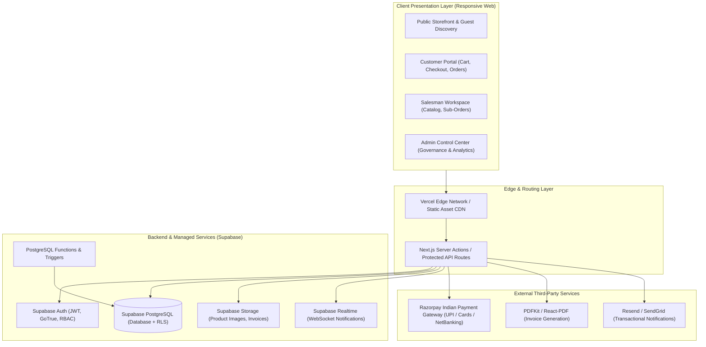

# E-COMMERCE MULTI-VENDOR MARKETPLACE
## Comprehensive Project Master Plan & Technical Architecture

---

### Document Control
- **Document Version:** 1.0.0
- **Document Type:** Architectural Blueprint & Project Management Plan
- **Primary Focus:** Architecture, Technology Selection, Risk Mitigation, Delivery Timelines & QA

---

## 1. System Architecture Overview

The multi-vendor e-commerce platform is architected as a **decoupled, modular cloud application** utilizing a high-performance frontend layer integrated directly with **Supabase (PostgreSQL, GoTrue Auth, Realtime Engine, Storage)** and an Indian payment gateway.



---

## 2. Technology Stack Selection & Justification

| Technology | Layer | Justification |
| :--- | :--- | :--- |
| **Next.js / React 18+** | Frontend & SSR | Provides hybrid Server-Side Rendering (SSR) for optimal SEO and product indexing, fast Incremental Static Regeneration (ISR), and integrated API/Server Actions. |
| **TypeScript** | Language | Enforces strict compile-time type safety across database schemas, API contracts, props, and financial transaction calculations. |
| **Tailwind CSS** | Styling Engine | Utility-first CSS ensuring rapid layout composition, zero runtime stylesheet overhead, and responsive breakpoint control. |
| **shadcn/ui** | Component System | Accessible, unstyled Radix-UI primitives with customizable Tailwind classes. Gives full control over component source code without restrictive third-party package dependencies. |
| **Supabase (PostgreSQL)** | Database & Backend | Enterprise relational engine with Native JSONB, ACID transactions, powerful connection pooling, and Row-Level Security (RLS) for data isolation. |
| **Supabase Auth** | Authentication | Built-in JWT-based identity management, secure session lifecycle, role claims, and integration with PostgreSQL RLS policies. |
| **Supabase Storage** | Object Storage | S3-compatible cloud object store with granular bucket policies for public product media and private invoice PDFs. |
| **Razorpay API** | Payments | Leading Indian payment gateway supporting UPI (intent & collect), Rupay/Visa/Mastercard debit and credit cards, NetBanking, and automated refund APIs. |
| **Recharts / Chart.js** | Data Visualization | Lightweight, responsive SVG/HTML5 charts for admin and vendor dashboard analytics. |

---

## 3. Core Architectural Subsystems

### 3.1 Authentication & Multi-Tenant Role Isolation
1. **User Identity Creation:** When a user registers via Supabase Auth, a database trigger automatically inserts a record into `public.profiles` with the designated role (`customer` or `salesman`).
2. **JWT Claims Injection:** The user's role is embedded into the Supabase JWT token, permitting immediate evaluation in both Next.js middleware and PostgreSQL RLS policies.
3. **Deep RLS Enforcement:** Even if a malicious client bypasses frontend checks, PostgreSQL rejects unauthorized SELECT, INSERT, UPDATE, or DELETE operations at the database engine level.

### 3.2 Inventory Locking & Race Condition Mitigation
To eliminate overselling during high-traffic sales events:
- Checkout operations invoke a dedicated PostgreSQL stored function `process_order_checkout()`.
- The function locks candidate product rows using `SELECT ... FOR UPDATE`.
- The transaction validates that `stock >= requested_qty` for all items.
- Inventory is atomically decremented, the master order and vendor sub-orders are committed, or the entire transaction rolls back with zero side effects.

### 3.3 Multi-Vendor Order Fulfillment Splitting
- A single customer purchase creates one **Master Order** (`orders` table) containing the aggregated billing address, customer ID, payment reference, and grand total.
- Concurrently, the system creates discrete **Sub-Orders** (`sub_orders` table) for each unique vendor involved in the cart.
- Each vendor receives their own sub-order reference with their respective `order_items`.
- Each vendor manages their own dispatch pipeline independently without blocking other vendors.

---

## 4. Milestone & Delivery Roadmap

The project is structured into **7 Distinct Phases** spanning a comprehensive 12-week development lifecycle:

```text
Week 1 - 2   : Phase 1 (Foundation, Database, Auth & Role Framework)
Week 3 - 4   : Phase 2 (Public Storefront, Catalog, Category Tree, Search & Filter)
Week 5 - 6   : Phase 3 (Salesman Workspace, Product CRUD & Vendor Order Engine)
Week 7 - 8   : Phase 4 (Cart, Multi-Vendor Checkout, Razorpay & Visual Tracking)
Week 9       : Phase 5 (Admin Control Center, Governance & Dynamic CMS Settings)
Week 10      : Phase 6 (In-App Notifications, PDF Invoices, Verified Reviews, Coupons)
Week 11 - 12 : Phase 7 (Security Hardening, RLS Audit, Concurrency Load Testing & Launch)
```

---

## 5. Risk Assessment & Mitigation Matrix

| Risk ID | Risk Description | Severity | Likelihood | Mitigation Strategy |
| :--- | :--- | :---: | :---: | :--- |
| **RSK-01** | **Inventory Overselling**<br>Multiple buyers checking out the last remaining item simultaneously. | HIGH | HIGH | Implement atomic PostgreSQL row-level locks (`SELECT ... FOR UPDATE`) in a database stored procedure for checkout. |
| **RSK-02** | **Payment Webhook Dropped**<br>Customer's bank deducts payment, but browser closes before redirect callback. | HIGH | MEDIUM | Implement idempotent Razorpay server-to-server webhooks with cryptographic HMAC signature verification and payment reconciliation jobs. |
| **RSK-03** | **Vendor Data Breach**<br>A vendor manipulates API parameters to view or tamper with another vendor's sales or customer data. | CRITICAL | LOW | Enforce strict PostgreSQL Row-Level Security (`salesman_id = (select auth.uid())`) on all sub-orders and product records. |
| **RSK-04** | **Malicious Product Content**<br>A vendor uploads counterfeit items, fraudulent pricing, or prohibited imagery. | MEDIUM | MEDIUM | Provide dynamic Admin Approval Toggle: when enabled, newly submitted items remain `pending_approval` until an admin reviews them. |
| **RSK-05** | **Multi-Vendor Refund Conflicts**<br>Customer requests return on an item from Vendor A, but keeps items from Vendor B. | MEDIUM | HIGH | Isolate refund workflows to individual `sub_orders` and `order_items`. Refunds calculate and disburse per vendor item without disrupting the overall master order. |

---

## 6. Quality Assurance & Testing Framework

### 6.1 Testing Pyramid
1. **Unit Testing:**
   - Calculation engines (cart subtotals, vendor commissions, tax distribution, coupon deductions).
   - Form input validation (PIN codes, Indian 10-digit phone numbers, GSTIN format).
2. **Integration Testing:**
   - Supabase Auth state transitions and role resolution.
   - Order creation and multi-vendor sub-order splitting triggers.
   - Razorpay payment signature verification routines.
3. **End-to-End (E2E) Flow Testing:**
   - Complete buyer journey: Guest search $\rightarrow$ Registration $\rightarrow$ Multi-vendor Cart $\rightarrow$ Simulated Checkout $\rightarrow$ Order Confirmed.
   - Vendor journey: Product Creation $\rightarrow$ Stock Update $\rightarrow$ Order Received $\rightarrow$ Status Advance to Shipped.
   - Admin journey: Vendor verification $\rightarrow$ Category addition $\rightarrow$ Banner modification $\rightarrow$ Analytics verification.
4. **Security & RLS Penetration Testing:**
   - Direct PostgREST SQL injection simulation.
   - Cross-tenant data access attempts using forged customer or vendor JWT tokens.

---

## 7. Deployment & CI/CD Pipeline

```text
[Developer Push to GitHub]
            |
            v
[GitHub Actions CI Pipeline]
    ├── 1. ESLint & TypeScript Compilation Check
    ├── 2. Automated Unit & Integration Tests Run
    └── 3. Supabase Database Migration Linting & Advisor Check
            |
    [Merge to Main]
            |
            +-----------------------+
            |                       |
            v                       v
    [Vercel Production]     [Supabase Production]
    - Automated Build       - Migrations Applied
    - Edge CDN Cache Invalidation - Schema Updated
    - Environment Variables Synced
```
